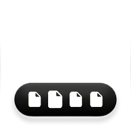
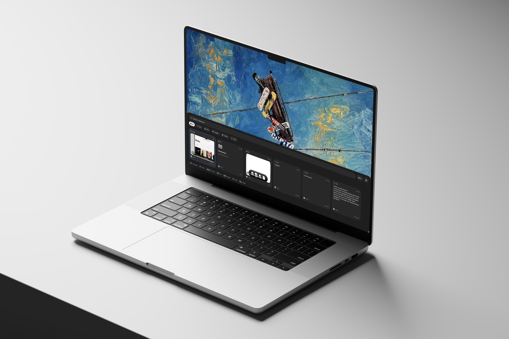

<div align="center">



# CopyStack

**Your clipboard, without the clutter.**

A lightweight macOS menu bar app for everything you copy.

<br>



<br>

`⌘ ⇧ V` Instant access&nbsp;&nbsp; · &nbsp;&nbsp;Text, links, images & files&nbsp;&nbsp; · &nbsp;&nbsp;Private & local

</div>

---

## Everything you copy. One place.

CopyStack keeps your clipboard history organized, searchable, and ready whenever you need it. Copy multiple items, find the one you want, and paste it instantly.

- **Instant access** — Open your clipboard from anywhere with `⌘ ⇧ V`.
- **Multiple formats** — Keep text, links, colors, images, and files together.
- **Quick search** — Find previously copied content without digging through your history.
- **Local by design** — Your clipboard history stays on your Mac.

## Installation

**1. Install with Homebrew**

```bash
brew install --cask sharky-3/copystack/copystack
```

**2. Allow the app to open**

If macOS blocks the first launch, open **System Settings → Privacy & Security** and select **Allow Anyway** next to the CopyStack security notification, if available.

**3. Launch CopyStack**

Open Spotlight with `⌘ Space`, search for `CopyStack`, and press Return.

Use `⌘ ⇧ V` to open your clipboard history.

## Updating

```bash
brew upgrade --cask copystack
```

</div>
